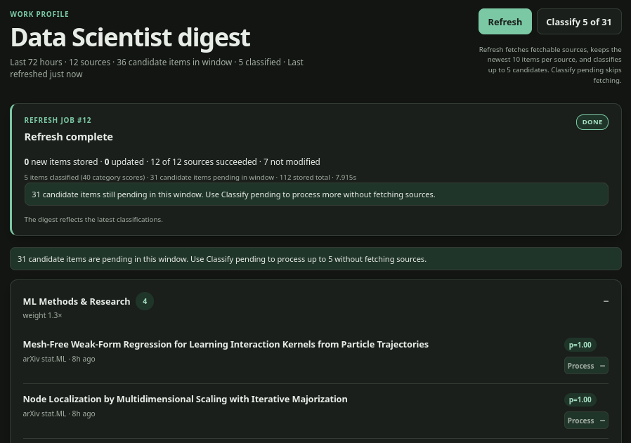
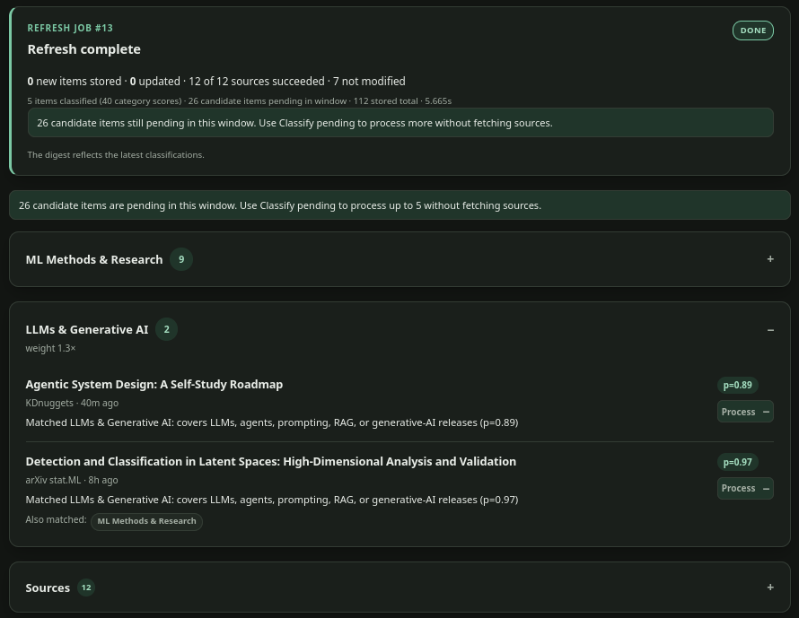
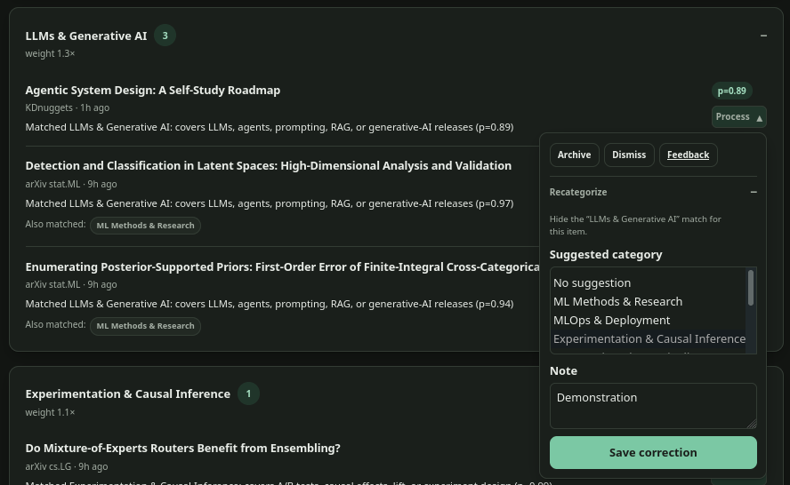
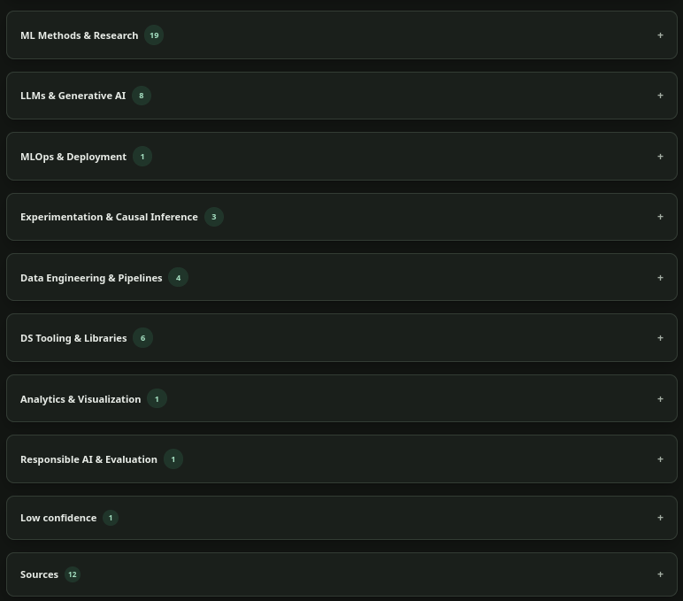
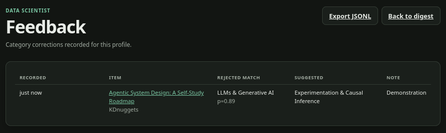
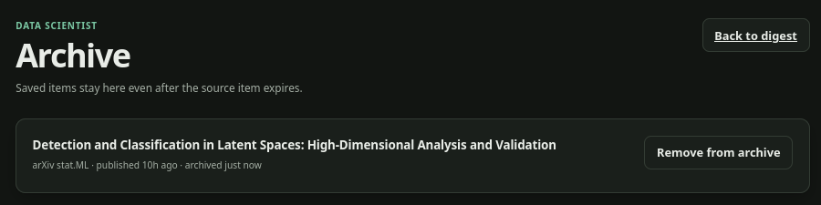
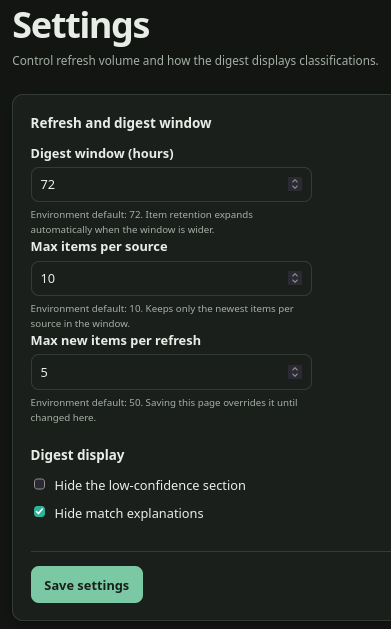
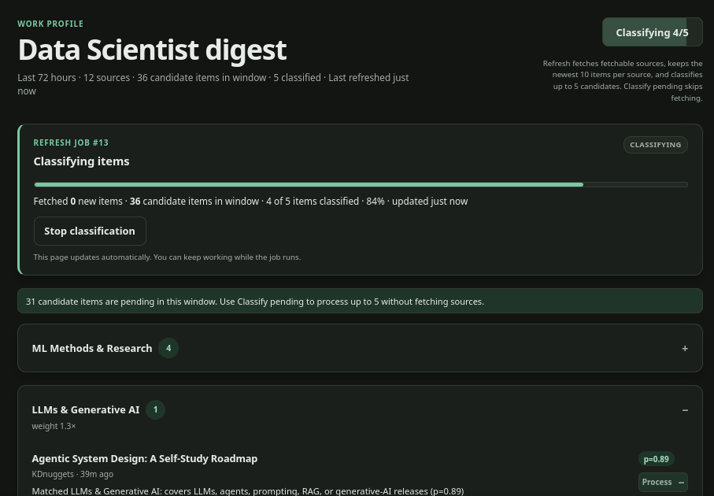
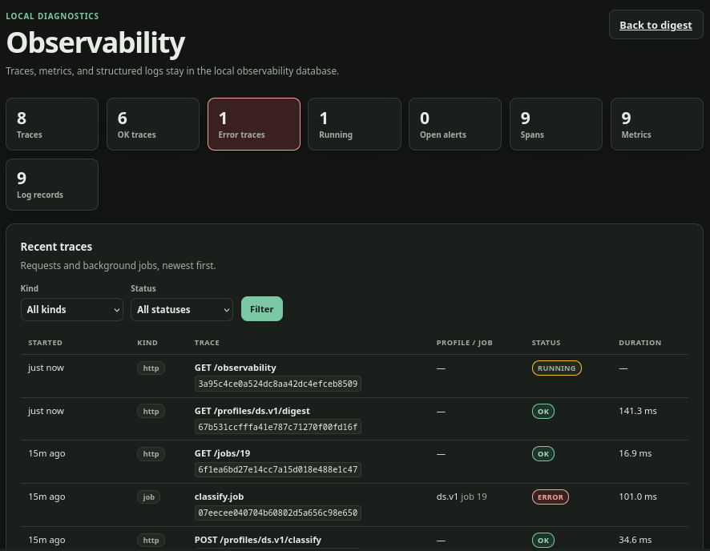
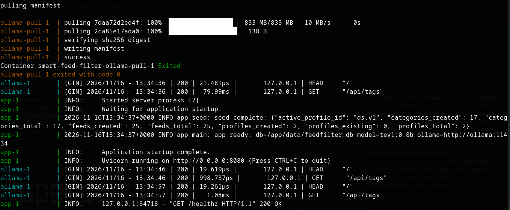

# Smart Feed Filter: Tuning My RSS Digest with a Local JEV-like model in Ollama

[](https://github.com/dmytrovoytko/rss-smart-feed-filter/actions/workflows/ci.yml)

**Smart Feed Filter** turns public RSS feeds into a short, category-grouped digest for one person.

The problem: professionals with RSS still drown in unread items, and generic readers sort by recency while AI summarizers add reading work instead of removing it.

Smart Feed Filter removes the triage step. You define a profile: a small set of categories, each with a name, description, criteria, and weight. A local decision model scores every feed item against those categories. The app shows the configured digest window (72 hours by default) grouped by category, ranked inside each category, with tags and (optionally) a one-line reason.

It's a filtering engine, not a summarizer. No article fetching, no private accounts, no generated prose. Each digest item has a Process menu to archive or dismiss it, reject a wrong category match, and inspect or export the feedback log.

Who gets a little more relaxed, or lazier? The data scientist who wants to skim only ML-method papers and skip hiring/funding noise; the off-work reader who wants hobby content without the feed becoming an everything feed.

## Workflow

Smart Feed Filter's workflow in two steps: 
1. the user defines a profile of weighted categories with plain-language criteria, 
2. then hits refresh to fetch and dedupe public RSS feeds while a local Ollama decision model scores each new item against the enabled categories, producing a digest for the configured window (72 hours by default) grouped and ranked by category.

```
User defines profile (categories, criteria, weights)
        │
        ▼
Manual refresh → fetch → dedupe → store
        │
        ▼
Local classifier (Ollama) scores new items
        │
        ▼
72h digest grouped by category, ranked by score
        │
        ▼
Process menu → archive, dismiss, recategorize, feedback
```

## Demo

- **Ranked digest**: profile switcher, per-category counts, ranked items, match probabilities, a completed refresh summary, and the Classify pending action for unprocessed items.

  

- **Multi-category matches**: an item appears in each category section it matches, with its score and Process menu.

  

- **Process corrections**: archive or dismiss an item, reject a wrong category match, and suggest another category, including disabled ones.

  

- **Low confidence and sources**: collapsed categories, low-confidence items, and source/category availability.

  

- **Feedback log**: recorded corrections with rejected and suggested categories, notes, and deterministic JSONL export.

  

- **Archived items**

  

- **Settings**: digest window, per-source item cap, new-item cap, and display preferences.

  

- **Refresh progress**: phase-aware job progress with stop-classification support.

  

- **Observability page**: shows summary counts, recent traces, kind/status filters, and local alerts.

  

## Code

[GitHub repo structure](https://github.com/dmytrovoytko/rss-smart-feed-filter)

```
├── .github
│   └── workflows
│       └── ci.yml
├── _docs
│   └── spec.md
├── app
│   ├── config.py
│   ├── db.py
│   ├── __init__.py
│   ├── logging_config.py
│   ├── __main__.py
│   ├── main.py
│   ├── observability.py
│   ├── observability_schema.sql
│   ├── routes/
│   ├── schema.sql
│   ├── seed.py
│   ├── services/
│   ├── static/
│   ├── templates/
│   ├── timeutil.py
│   └── versioning.py
├── data
│   ├── feedfilter.db        # generated at runtime (not committed)
│   └── observability.db     # local diagnostics only (not committed)
├── eval/
├── profiles
│   ├── catalog.yaml
│   ├── ds.v1.yaml
│   └── fun.v1.yaml
├── tests/
├── .dockerignore
├── Dockerfile
├── docker-compose.yml
├── pyproject.toml
└── requirements.txt
```

## Quickstart

Requirements: Python 3.12+ and a local [Ollama](https://ollama.com) install.

```bash
pip install -e .
ollama pull tev1:0.8b
cp .env.example .env   # optional locally; required for Docker Compose
feed-filter
```

Then open <http://127.0.0.1:8000> and press **Refresh** to build the first digest. On first run the app creates the SQLite database under `data/` and seeds both `ds.v1` and `fun.v1` profiles with their feed catalogs. If the new-item cap leaves items pending, use **Classify pending** to process more without fetching the sources again.

The header switches between profiles and opens the Archive and Feedback pages. The **Settings** page controls the digest window, max items per source, max new items per refresh, hides the low-confidence section, and hides match explanations.

### Refresh and classify

**Refresh** fetches enabled feeds, stores new items, and classifies up to `MAX_NEW_ITEMS`. The first successful fetch uses the configured window; later fetches look back `REFRESH_OVERLAP_HOURS` behind the last non-error fetch. **Classify pending** skips fetching and classifies up to the same cap. Both run as local jobs; only one job runs at a time. During classification, **Stop** requests a graceful stop and keeps completed classifications.

### Processing a digest

Use the per-item **Process** menu on matched or low-confidence entries:

- **Archive** hides the item and keeps a snapshot on the Archive page, even after normal item retention.
- **Dismiss** hides the item permanently for that item's lifetime; there is no undo.
- **Recategorize** rejects one category match, optionally suggests another profile category (disabled suggestions are labeled and stay disabled), and adds a note; it hides only that match.
- **Feedback** opens the correction log filtered to the item; the Feedback page also exports deterministic JSONL.

Archived items stay out of the digest and candidate counts. Removing one from the Archive page converts it to a dismissal while the underlying item exists.

## Observability and alerts

Diagnostics are local. The app writes traces, spans, metrics, structured log records, and alerts to a second SQLite database, kept separate from the digest database. No external telemetry service is called, and no account is required.

- **Observability page**: open **Observability** in the header or go to <http://127.0.0.1:8000/observability>. It shows summary counts, recent traces, kind/status filters, and local alerts.
- **Traces**: each request and refresh/classify job gets a trace ID. HTTP responses include `X-Trace-ID`; static assets, `/favicon.ico`, and `/healthz` are excluded. Open a trace to inspect its spans, metrics, and structured logs. Refresh traces include `feed.fetch`, `classify.items`, and `job.persist` spans.
- **Alerts**: failed jobs, classification/Ollama failures, all-feeds-failed refreshes, and empty digests after a successful refresh create local alerts. The digest shows an alert banner for the active profile. Open alerts are deduplicated by profile and code; use **Acknowledge** on the Observability page to close one.
- **Health**: `/healthz` keeps the existing table counts and adds `observability.status` plus `observability.open_alerts`. The Docker healthcheck is unchanged.
- **Privacy**: the observability database stores IDs, counts, durations, statuses, event names, sanitized error-class messages, and URL-sanitized text. It does not store article titles, summaries, feed titles, model prompts, credentials, or external telemetry.
- **Configuration**: `OBS_DB_PATH` selects the observability database and defaults to `./data/observability.db`; it must differ from `DB_PATH`. Compose passes `OBS_DB_PATH` through to `/app/data/observability.db` in the existing `feedfilter-data` volume.
- **Reset**: stop the app, delete the file, and restart to recreate the schema:

  ```bash
  rm -f data/observability.db
  ```

  This removes local diagnostics and alert history only; the digest database and profiles are untouched. In Compose the file lives at `/app/data/observability.db` inside the `feedfilter-data` volume.

## Docker Compose

The full stack also runs with Docker Compose, including Ollama. Compose reads `.env`, so create it first. You can use Podman instead of Docker if you prefer:

```bash
cp .env.example .env
docker compose up --build
```

Then open <http://127.0.0.1:8000>. Compose starts three services: `ollama`, a one-shot `ollama-pull` that fetches `TEV_MODEL`, and `app`. SQLite data and downloaded models persist in named volumes.

If port 8000 is busy on your machine, you can change PORT in `.env`, to 8080 for example: 

  

Compose passes behavioral settings from `.env` (`TEV_MODEL`, `PORT`, `LOG_LEVEL`, `MAX_NEW_ITEMS`, `MAX_ITEMS_PER_FEED`, `REFRESH_OVERLAP_HOURS`, `RETENTION_DAYS`, `WINDOW_HOURS`, `RESCORE_DAYS`, `THRESHOLD`, `DB_PATH`, `OBS_DB_PATH`, `LOG_PATH`). Two values are container-specific:

| Variable | Default | Purpose |
|---|---|---|
| `OLLAMA_BASE_URL_DOCKER` | `http://ollama:11434` | App-to-Ollama endpoint inside Compose; set to `http://host.docker.internal:11434` for a host Ollama |
| `OLLAMA_PUBLISH_HOST` | `127.0.0.1` | Host interface for the published Ollama port |

The app binds `0.0.0.0` inside the container, but its host port and the Ollama host port are published on loopback by default. Relative `DB_PATH`/`OBS_DB_PATH`/`LOG_PATH` values resolve under `/app` and persist in the `feedfilter-data` volume; custom absolute paths need a matching volume mount.

## Configuration

Settings come from the environment or a local `.env` file; `.env.example` lists the common settings.

| Variable | Default | Purpose |
|---|---|---|
| `OLLAMA_BASE_URL` | `http://127.0.0.1:11434` | Local Ollama endpoint |
| `TEV_MODEL` | `tev1:0.8b` | Decision model |
| `DB_PATH` | `./data/feedfilter.db` | SQLite database file |
| `OBS_DB_PATH` | `./data/observability.db` | Separate local observability database; must differ from `DB_PATH` |
| `LOG_PATH` | `./data/feedfilter.log` | Log file |
| `LOG_LEVEL` | `INFO` | Log verbosity |
| `HOST` | `127.0.0.1` | Bind address |
| `PORT` | `8000` | HTTP port |
| `MAX_NEW_ITEMS` | `50` | Environment default; the Settings page can override it |
| `MAX_ITEMS_PER_FEED` | `10` | Environment default; the Settings page can override it |
| `REFRESH_OVERLAP_HOURS` | `6` | Overlap behind the last non-error fetch for later fetches |
| `RETENTION_DAYS` | `30` | Job retention; item retention expands when the digest window is wider |
| `WINDOW_HOURS` | `72` | Environment default; the Settings page can override it |
| `RESCORE_DAYS` | `14` | Reserved; no rescore flow |
| `THRESHOLD` | `0.55` | Default match threshold for new profiles |

## Testing and CI

Unit and service tests plus FastAPI `TestClient` integration tests live under `tests/`:

```bash
pip install -e '.[dev]'
python -m unittest discover -s tests -v
ruff check .
```

The integration tests exercise the digest, processing actions, archive and feedback pages, JSONL export, settings, profile switching, refresh, classify pending, job fragment, stop, retry, `/healthz`, the Observability dashboard and trace detail, alert creation/acknowledgement, and database recreation against temporary SQLite databases without calling Ollama over the network.

GitHub Actions runs lint and the full test suite on every push and pull request via [`.github/workflows/ci.yml`](.github/workflows/ci.yml).

## How I Built It

### Architecture

- Python 3.12+, FastAPI, Jinja2 + HTMX, SQLite WAL, feedparser, requests, PyYAML, pydantic, python-dateutil, uvicorn.
- Local decision model via Ollama: model `tev1:0.8b`, POST /v1/systemone. No fallback model is wired.
- State = title + summary, truncated to 1200 chars word boundary; no article fetching; no HTML.
- One noul question per enabled category per item; up to 16 categories.
- Threshold by profile, 0.55 default; match when probability ≥ threshold; low confidence collapsed by default.
- Ranking: probability × weight × recency decay; 72h window; dedupe canonical URL + normalized title; item retention expands with wider windows, while job retention stays at `RETENTION_DAYS`.
- Jobs: refresh and classify share a persisted, phase-aware runner; classification can be stopped without losing completed scores.
- Observability: a separate local SQLite database stores correlated traces, spans, metrics, structured logs, and alerts; `/observability` and `/observability/traces/{trace_id}` expose them without an external service.
- Error handling: persisted job state, actionable banner (`ollama serve`, `ollama pull tev1:0.8b`), retry classifies only missing items, and local alerts for user-impact failures.

Reasons are templated, never generated. Ranking handles ordering. Refresh and Classify pending run as local jobs; no retroactive re-score or category editing UI is implemented.

Before building UI, I ran a model gate via `python eval/harness.py --gate`: a 100-item labeled set (50 per profile) scored on macro-F1, precision@10, latency, and failures. Despite falling short of the originally set targets, I continued with the local `tev1:0.8b` model after category and threshold tuning. No `tev1:4b` results were recorded and the fallback was not adopted.

### The hard part

Categorizing work content was (is?) harder than off-work (fun) content because real-world topics overlap heavily (ML methods vs. LLM apps vs. MLOps vs. experimentation), which is exactly why the spec encodes separate criteria fields and why `ds.v1` needed more tuning cycles than the fun profile.

Here is the sample of [`ds.v1` profile](profiles/ds.v1.yaml):

```
id: ds.v1
name: Data Scientist
kind: work
version: 1
threshold: 0.62
max_categories: 16
seed: true
description: >
  Professional reading profile for data scientists and ML practitioners.
  Prefers methods, production practice, analytics, and responsible AI over
  general technology news, hiring, funding, and product marketing.
exclude_hints:
  - hiring, recruiting, and career advice
  - funding, acquisitions, and business news
  - consumer gadgets and general technology policy
  - health or medical advice
categories:
  - id: ml-research
    name: ML Methods & Research
    description: >-
      New machine-learning methods, architectures, training techniques,
      benchmarks, or results from research papers and research labs.
    criteria_true: >-
      The item reports or analyzes a machine-learning method, model, benchmark,
      training technique, or research finding.
    criteria_false: >-
      The item is product news, production operations, business news, career
      advice, or not about machine-learning methods.
    reason_hint: covers methods, architectures, benchmarks, or research findings
    weight: 1.3
    enabled: true
```

Each category can be enabled/disabled. For example, you can turn off "Responsible AI & Evaluation" after getting enough value, then re-enable it later. The same category structure can be used in another seed profile for a different domain, with categories for different topics and their own criteria.
