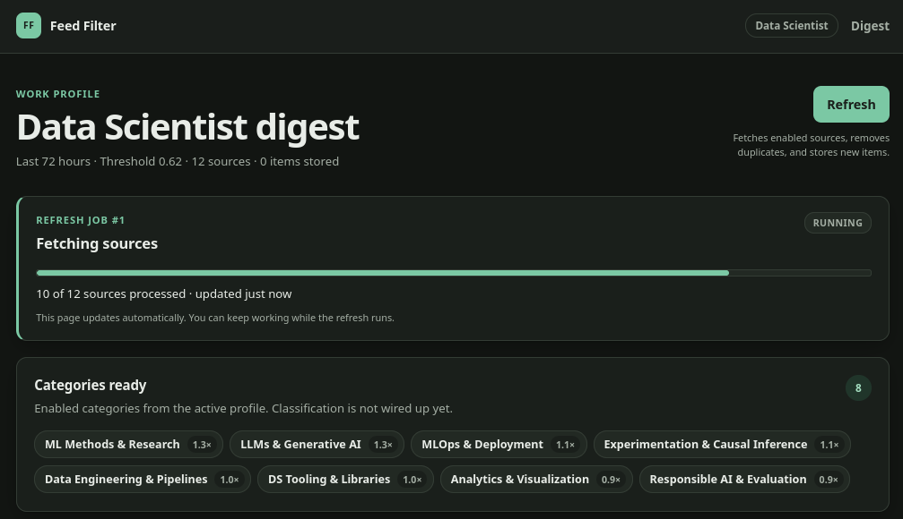
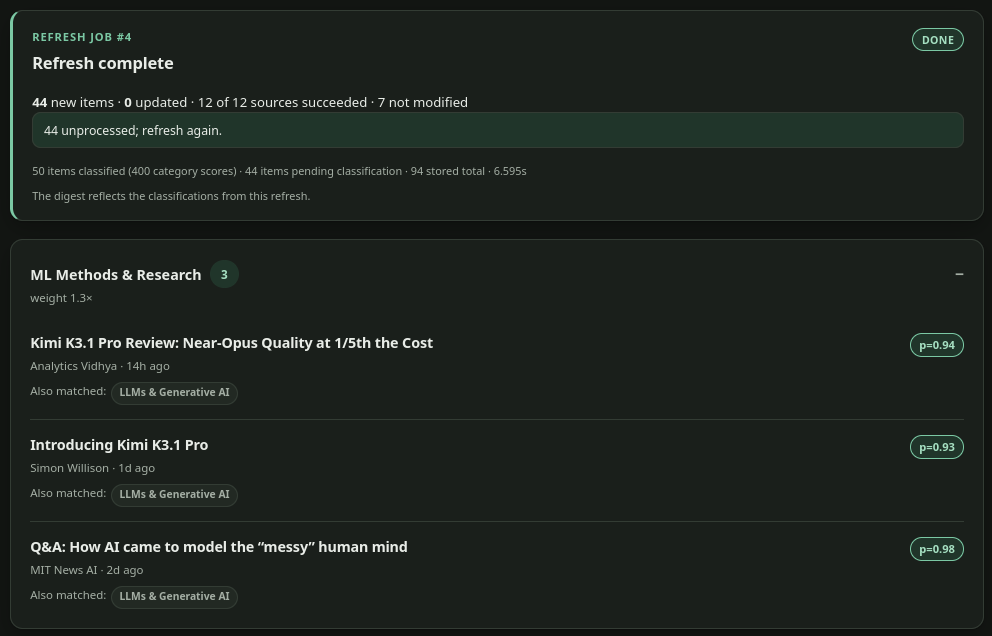
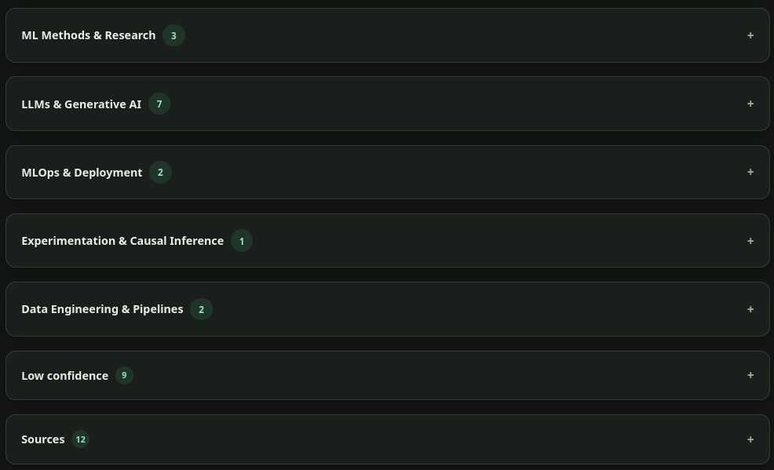

# Smart Feed Filter: Tuning My RSS Digest with a Local JEV-like model in Ollama

[](https://github.com/dmytrovoytko/rss-smart-feed-filter/actions/workflows/ci.yml)

**Smart Feed Filter** turns public RSS feeds into a short, category-grouped digest for one person.

The problem: professionals with RSS still drown in unread items, and generic readers sort by recency while AI summarizers add reading work instead of removing it.

Smart Feed Filter removes the triage step. You define a profile: a small set of categories, each with a name, description, criteria, and weight. A local decision model scores every feed item against those categories. The app shows the last 72 hours grouped by category, ranked inside each category, with tags and (optionally) a one-line reason.

It's a filtering engine, not a summarizer. No article fetching, no private accounts, no generated prose.

Who gets a little more relaxed, or lazier? The data scientist who wants to skim only ML-method papers and skip hiring/funding noise; the off-work reader who wants hobby content without the feed becoming an everything feed.

## Workflow

Smart Feed Filter's workflow in two steps: 
1. the user defines a profile of weighted categories with plain-language criteria, 
2. then hits refresh to fetch and dedupe public RSS feeds while a local Ollama decision model scores each new item against the enabled categories, producing a 72-hour digest grouped and ranked by category.

```
User defines profile (categories, criteria, weights)
        │
        ▼
Manual refresh → fetch → dedupe → store
        │
        ▼
Local classifier (Ollama) scores new items
        │
        ▼
72h digest grouped by category, ranked by score
```

## Demo

- Smart Feed categorization processing



- Digest grouped by category, ranked items with match confidence



- Digest grouped by category, collapsed, including `Low confidence` group and sources



## Code

[GitHub repo structure](https://github.com/dmytrovoytko/rss-smart-feed-filter)

```
├── .github
│   └── workflows
│       └── ci.yml
├── _docs
│   └── spec.md
├── app
│   ├── config.py
│   ├── db.py
│   ├── __init__.py
│   ├── logging_config.py
│   ├── __main__.py
│   ├── main.py
│   ├── routes/
│   ├── schema.sql
│   ├── seed.py
│   ├── services/
│   ├── static/
│   ├── templates/
│   ├── timeutil.py
│   └── versioning.py
├── data
│   └── feedfilter.db   # generated at runtime (not committed)
├── eval/
├── profiles
│   ├── catalog.yaml
│   ├── ds.v1.yaml
│   └── fun.v1.yaml
├── tests/
├── .dockerignore
├── Dockerfile
├── docker-compose.yml
├── pyproject.toml
└── requirements.txt
```

## Quickstart

Requirements: Python 3.12+ and a local [Ollama](https://ollama.com) install.

```bash
pip install -e .
ollama pull tev1:0.8b
cp .env.example .env   # optional locally; required for Docker Compose
feed-filter
```

Then open <http://127.0.0.1:8000> and press **Refresh** to build the first digest. On first run the app creates the SQLite database under `data/` and seeds both `ds.v1` and `fun.v1` profiles with their feed catalogs.

## Docker Compose

The full stack also runs with Docker Compose, including Ollama. Compose reads `.env`, so create it first:

```bash
cp .env.example .env
docker compose up --build
```

Then open <http://127.0.0.1:8000>. Compose starts three services: `ollama`, a one-shot `ollama-pull` that fetches `TEV_MODEL`, and `app`. SQLite data and downloaded models persist in named volumes.

Compose passes behavioral settings from `.env` (`TEV_MODEL`, `PORT`, `LOG_LEVEL`, `MAX_NEW_ITEMS`, `RETENTION_DAYS`, `WINDOW_HOURS`, `RESCORE_DAYS`, `THRESHOLD`, `DB_PATH`, `LOG_PATH`). Two values are container-specific:

| Variable | Default | Purpose |
|---|---|---|
| `OLLAMA_BASE_URL_DOCKER` | `http://ollama:11434` | App-to-Ollama endpoint inside Compose; set to `http://host.docker.internal:11434` for a host Ollama |
| `OLLAMA_PUBLISH_HOST` | `127.0.0.1` | Host interface for the published Ollama port |

The app binds `0.0.0.0` inside the container, but its host port and the Ollama host port are published on loopback by default. Relative `DB_PATH`/`LOG_PATH` values resolve under `/app` and persist in the `feedfilter-data` volume; custom absolute paths need a matching volume mount.

## Configuration

Settings come from the environment or a local `.env` file; `.env.example` lists them all.

| Variable | Default | Purpose |
|---|---|---|
| `OLLAMA_BASE_URL` | `http://127.0.0.1:11434` | Local Ollama endpoint |
| `TEV_MODEL` | `tev1:0.8b` | Decision model |
| `DB_PATH` | `./data/feedfilter.db` | SQLite database file |
| `LOG_PATH` | `./data/feedfilter.log` | Log file |
| `LOG_LEVEL` | `INFO` | Log verbosity |
| `HOST` | `127.0.0.1` | Bind address |
| `PORT` | `8000` | HTTP port |
| `MAX_NEW_ITEMS` | `50` | Items classified per refresh |
| `RETENTION_DAYS` | `30` | Item retention |
| `WINDOW_HOURS` | `72` | Digest window |
| `RESCORE_DAYS` | `14` | Retroactive re-score window |
| `THRESHOLD` | `0.55` | Default match threshold for new profiles |

## Testing and CI

Unit and service tests plus FastAPI `TestClient` integration tests live under `tests/`:

```bash
python -m unittest discover -s tests -v
ruff check .
```

The integration tests exercise the digest, refresh, job fragment, retry, and `/healthz` routes against a temporary SQLite database without calling Ollama over the network.

GitHub Actions runs lint and the full test suite on every push and pull request via [`.github/workflows/ci.yml`](.github/workflows/ci.yml).

## How I Built It

### Architecture

- Python 3.12+, FastAPI, Jinja2 + HTMX, SQLite WAL, feedparser, requests, PyYAML, pydantic, python-dateutil, uvicorn.
- Local decision model via Ollama: model `tev1:0.8b` (fallback `tev1:4b`), POST /v1/systemone. 
- State = title + summary, truncated to 1200 chars word boundary; no article fetching; no HTML.
- One noul question per enabled category per item; up to 16 categories.
- Threshold by profile, 0.55 default; match when probability ≥ threshold; low confidence collapsed by default.
- Ranking: probability × weight × recency decay; 72h window; dedupe canonical URL + normalized title; retention 30 days.
- Retroactive edits: preview re-scores last 14 days, atomic apply, cancel discards.
- Error handling: persisted job state, actionable banner (`ollama serve`, `ollama pull tev1:0.8b`), retry classifies only missing.

Reasons are templated, never generated. Ranking handles ordering. Retroactive edits use a preview-diff-then-atomic-apply flow over the last 14 days; weight edits reorder without model calls, threshold edits re-filter cached probabilities.

Before building UI, I ran a model gate via `python eval/harness.py --gate`: a 100-item labeled set (50 per profile) scored on macro-F1, precision@10, latency, and failures. Despite falling short of the originally set targets the local `tev1:0.8b` model results satisfied my expectations after category and threshold tuning; fallback `tev1:4b` documented.

### The hard part

Categorizing work content was (is?) harder than off-work (fun) content because real-world topics overlap heavily (ML methods vs. LLM apps vs. MLOps vs. experimentation), which is exactly why the spec encodes separate criteria fields and why `ds.v1` needed more tuning cycles than the fun profile.

Here is the sample of [`ds.v1` profile](profiles/ds.v1.yaml):

```
id: ds.v1
name: Data Scientist
kind: work
version: 1
threshold: 0.62
max_categories: 16
seed: true
description: >
  Professional reading profile for data scientists and ML practitioners.
  Prefers methods, production practice, analytics, and responsible AI over
  general technology news, hiring, funding, and product marketing.
exclude_hints:
  - hiring, recruiting, and career advice
  - funding, acquisitions, and business news
  - consumer gadgets and general technology policy
  - health or medical advice
categories:
  - id: ml-research
    name: ML Methods & Research
    description: >-
      New machine-learning methods, architectures, training techniques,
      benchmarks, or results from research papers and research labs.
    criteria_true: >-
      The item reports or analyzes a machine-learning method, model, benchmark,
      training technique, or research finding.
    criteria_false: >-
      The item is product news, production operations, business news, career
      advice, or not about machine-learning methods.
    reason_hint: covers methods, architectures, benchmarks, or research findings
    weight: 1.3
    enabled: true
```

Each category can be enabled/disabled. So for example you can be interested in some topic like "Responsible AI & Evaluation", and after getting enough valuable information just turn it off - until you need it again. Similarly with job search and vacancies - your `job-search` profile can include categories for different positions with their own criteria.